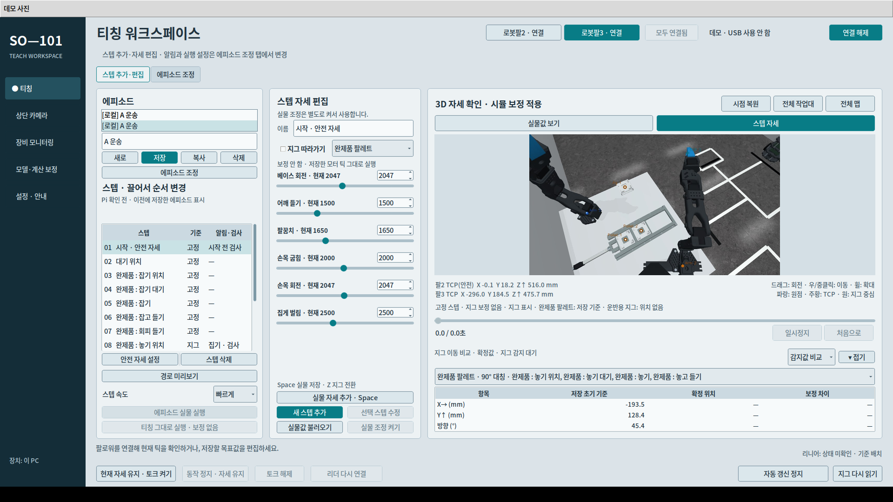

# OpenCV Teach · SO-101 조립대 티칭

카메라로 지그의 위치·방향을 찾고, 저장된 티칭 기준과의 차이를 반영해 로봇팔의 집기·놓기 목표를 보정하는 프로그램입니다. 조립대의 로봇팔2·3과 리니어를 연결하는 PC 티칭 GUI와 Pi 실행 코드를 담았습니다.

**[Windows·Linux 데모 다운로드](https://github.com/7s-FA/opencv-teach/releases/latest)** · [이전 SO-101 작업](https://github.com/7s-FA/so101-workbench)

## 2026-10-20 검사·실행 준비·UI 갱신

[현재 적용 구조와 Pi 비교](docs/vision/2026-10-20/README.md): AI 라벨 + CAD 안착 검사, 위치 변경 시 조기 채택 무효화, 동일 영상 AI 공유와 시작 검사·경로 계산 병행, 관제 명령·UI·사진 기준 3D 외관을 반영했습니다. [업무·검증 기록](docs/progress-2026-10-20.md)에 실물·저장 영상·공개 데모의 검증 범위를 구분했습니다.

현재 작업대의 AI 인식 탭은 PC YOLO26x TensorRT FP16·SAM3 BF16, Pi YOLO26s·YOLO26n NCNN FP16을 지원합니다. 공개 데모는 저장 사진과 OpenCV를 사용하며 학습 가중치는 포함하지 않습니다. 아래 날짜별 기록은 당시의 평가·적용 상태입니다.

## 2026-10-19 지그·안착 검사 갱신

[현재 적용 구조·검증 결과](docs/vision/2026-10-19/README.md): 운반용 지그의 OpenCV 외곽·격자·방향 검증, 팔레트의 AI 마스크·CAD 정합, 지그별 첫 3회 조기 채택을 반영했습니다. 안착 검사는 YOLO 라벨을 우선하고 OpenCV·CAD로 위치·각도·경계를 확인합니다. 빈 팔레트 배경 오판과 어두운 AI 마스크 돌출부를 수정하고, ROI 이탈의 구체적인 이유를 표시합니다.

[오늘 업무 일지](docs/progress-2026-10-19.md)에는 실물 측정·저장 영상 재생·검수 대기와 미검증 범위를 구분했습니다. 현재 작업대의 PC·Pi 적용과 공개 데모를 구분하며, 학습 가중치와 개인 장치 실행 설정은 이 저장소에 포함하지 않습니다.

## 2026-10-17 모델 비교 완료 · 당시 기록

[YOLO26x·SAM3 최종 비교](docs/models/2026-10-17/README.md): 같은 가상+실물 혼합 학습 후 실물 테스트 31장·169개 객체로 평가했습니다. YOLO26x TensorRT FP16은 AP 98.93점·오검출/누락 0/0, SAM3 BF16은 98.59점·1/2입니다. 전체 처리 중앙값은 16.50ms / 494.31ms입니다. SAM3는 19에포크 종료·최적 14에포크이며, 비교를 마친 당시에는 앱 미배포 상태였습니다. 현재 연결 상태는 위 10월 20일 설명을 따릅니다. 최종 검증과 문서 반영은 10월 18일 완료했습니다.

## 2026-10-16 갱신

- 전체 공장 맵·3D 표시, 지그 외곽·방향 판정, 오류 기록, 카메라·촬영 화면을 최신 티칭 코드로 갱신했습니다.
- 사진 촬영 버튼은 **좌클릭 저장·우클릭 선택 사진 묶음 삭제**를 지원합니다. 긴 안내 잘림과 불필요한 표시 전환을 줄였습니다.
- [YOLO 부품 인식 모델 9종 비교](docs/models/2026-10-16/README.md): 실물·시뮬레이션·혼합 학습 × 원본·**FP16(16비트 실수)**·**INT8(8비트 정수 혼합)**. 파이 권장은 혼합 학습 FP16이며, 기존 티칭 앱의 판정에 자동 적용된 기능은 아닙니다.
- [10월 13~16일 개발 현황과 검증 범위](docs/progress-2026-10-16.md)

## 다운로드해서 실행

[최신 릴리스](https://github.com/7s-FA/opencv-teach/releases/latest)의 운영체제에 맞는 파일을 받으세요. GitHub 로그인이나 Python 설치 없이 실행할 수 있습니다.

| 운영체제 | 다운로드 | 실행 |
|---|---|---|
| Windows 10/11 · x64 | `SO101-Teach-Demo-Windows-x64.zip` | 전체 압축 해제 → `SO101-Teach-Demo.exe` |
| Ubuntu 22.04/24.04 · x64 | `SO101-Teach-Demo-Linux-x64.tar.gz` | 전체 압축 해제 → `SO101-Teach-Demo` |

원본 GUI의 3D 작업대·로봇팔, 티칭 편집·저장, OpenCV 검출을 실행합니다. 기본 카메라 입력은 **두 지그가 모두 검출되는 저장 사진**입니다. **데모 사진** 메뉴에서 조립 완료·오안착 사진을 선택할 수 있습니다. 모터는 가상 장치이며 실제 USB·카메라·Pi·네트워크 연결은 차단합니다. 편집 내용은 PC의 별도 데모 폴더에 유지됩니다.

웹 데모와 Codespaces 실행은 사용하지 않습니다. 운영체제 요구사항·데이터 위치·실행 오류 안내는 [다운로드 데모 설명](desktop-demo/README.md)을 확인하세요.



[두 지그를 검출한 카메라 화면](docs/desktop-camera.png)

## 핵심 흐름

1. 자세와 지그 기준을 함께 저장합니다.
2. 실행 전에 카메라로 현재 지그 위치·방향을 다시 읽습니다.
3. 저장한 지그 상대 위치를 현재 기준으로 옮겨 목표 자세를 계산합니다.
4. Pi에서 작업 스텝을 실행합니다. 부품·조립 검사는 필요한 단계에서 추가로 사용합니다.

## 구성

| 경로 | 내용 |
|---|---|
| `SO101_teach/` | 원본 PC 티칭 GUI, Pi 실행 코드, 모델, 테스트, 예제 데이터 |
| `desktop-demo/` | 다운로드 데모 입력 어댑터, 패키징, 실행 검증 |
| `third-party-licenses/` | 포함된 외부 모델·코드의 라이선스 |

예제 보정값과 에피소드는 개발 당시 장비의 예제이며 다른 팔에 그대로 적용하는 실행 설정이 아닙니다.

## 소스로 실행·개발

Linux에서 Python 3.12와 Tk가 필요합니다. Ubuntu에서는 `python3-tk`를 설치합니다.

```bash
python3 -m venv .venv
source .venv/bin/activate
pip install -r desktop-demo/requirements-build.txt
python desktop-demo/app.py
```

실제 장치 연결·보정·Pi 배포는 [프로그램 설명](SO101_teach/README.md), [지그 보정](SO101_teach/JIG_FOLLOWING.md), [Pi 준비](SO101_teach/PI_SETUP.md), [통합 실행](SO101_teach/INTEGRATION.md)을 확인하세요. 원본 실행용 예제 초기화는 `python SO101_teach/tools/init_demo.py`로 수행하며, 기존 `data/`가 있으면 보존합니다.

GitHub Actions에서 Windows와 Ubuntu의 독립 실행 파일을 각각 빌드하고 원본 Tk 화면, 양쪽 로봇팔 3D, 두 지그 검출, 사진 변경, 저장 유지, 실제 연결 차단을 검사합니다. 화면 기준은 [DESIGN.md](SO101_teach/DESIGN.md)입니다. 외부 모델은 원래 라이선스를 따르며 프로젝트 전체에 새로운 재배포 라이선스를 부여하지 않았습니다.
