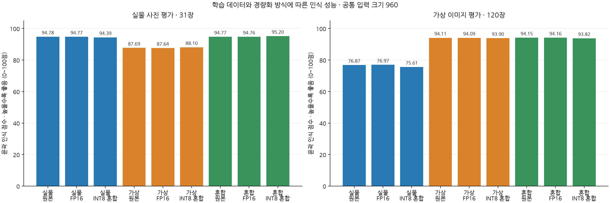
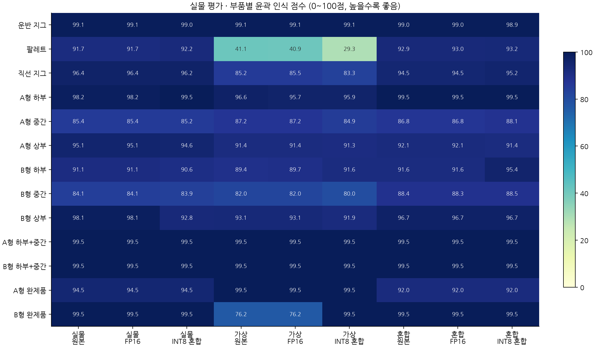
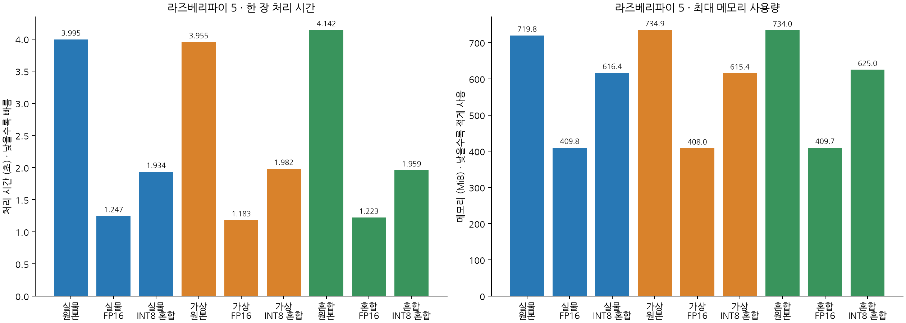

# YOLO 부품 인식 모델 · 학습·양자화·파이 비교

기준일: 2026-10-16 · 9종 평가 완료 · 파이 실측 9종 완료

## 결론

실물+시뮬레이션 혼합 학습 YOLO26s-seg의 NCNN FP16 모델 권장. 실물 31장·169개 객체에서 잘못 검출한 수와 놓친 수 모두 0개. 라즈베리파이 5 처리 시간 1.223초/장, 약 0.82장/초, 최대 메모리 409.7MiB. 모델 학습·변환·평가와 파이 단독 추론까지 완료. 티칭 앱의 기존 판정·모터 제어에 추천 모델을 자동 적용한 상태는 아님.

## 모델이 하는 일

상단 카메라 이미지에서 운반 지그·팔레트·리니어 지그와 A/B 단품·조립체를 13개 종류로 구분하고, 화면에 보이는 물체 영역을 픽셀 단위 마스크로 추정. 물체의 실제 높이·로봇 좌표·안착 성공·집기 성공은 이 모델 점수만으로 확정하지 않음.

| 번호 | 구분 | 모델 클래스 이름 |
| --- | --- | --- |
| 0 | 운반 지그 | carrier_jig |
| 1 | 완제품 팔레트 | pallet |
| 2 | 리니어 조립 지그 | linear_jig |
| 3~5 | A형 하단·중단·상단 | A_lower / A_middle / A_upper |
| 6~8 | B형 하단·중단·상단 | B_lower / B_middle / B_upper |
| 9~10 | A/B형 하단+중단 조립체 | A_lower_middle / B_lower_middle |
| 11~12 | A/B형 완제품 | A_complete / B_complete |

## FP16과 INT8 표기

FP는 부동소수점(실수), INT는 정수 형식. FP16은 16비트 실수 정밀도로 변환한 NCNN 모델. INT8은 가상·실물 등 각 모델의 학습 이미지로 보정한 ONNX 8비트 정수 양자화 모델. 입력 합성곱·어텐션·최종 출력층 일부와 비합성곱 연산은 FP32(32비트 실수)로 남긴 혼합 정밀도 방식. 원본 PyTorch 체크포인트를 일괄 FP32 모델로 표기하지 않음. 실행 엔진도 달라 이번 속도 차이를 비트 수만의 효과로 해석하지 않음.

## 데이터와 공통 평가 조건

가상 이미지 1,200장: 학습 960 / 검증 120 / 테스트 120. 리니어 전진·후진·중간 위치 각 400장, 조명 세기·색온도·방향과 부품 배치 변주 포함. 실물 v7은 사진 304장·정답 객체 1,675개: 학습 243 / 검증 30 / 테스트 31. 혼합 학습은 학습 1,203장 / 검증 150장. 세 학습 모두 YOLO26s-seg 사전학습 모델에서 시작하고 입력 960 사용. 최적 체크포인트는 각 검증셋으로 선택하며 공통 테스트는 학습·모델 선택·INT8 보정에서 제외.

## 윤곽 점수와 개수 읽는 법

윤곽 인식 점수는 마스크 mAP50–95를 0~100점으로 표시한 값으로, 단순 정답률(%)이 아님. 잘못 검출한 수·놓친 수는 신뢰도 0.25 이상에서 같은 클래스의 원본 픽셀 마스크 겹침 비율(IoU) 0.5 이상을 일대일 대응한 결과. 표준 mAP는 Ultralytics 평가, 개수는 배포용 후처리 기준. INT8의 동점 후보 선택에서 두 후처리의 결과가 달라질 수 있음.

| 학습 이미지 | 경량화 형식 | 실물 윤곽 점수 ↑ | 시뮬 윤곽 점수 ↑ | 잘못 검출한 수 ↓ | 놓친 수 ↓ |
| --- | --- | --- | --- | --- | --- |
| 실물 | 원본 PyTorch | 94.78 | 76.87 | 0 | 0 |
| 실물 | FP16 · 16비트 실수 | 94.77 | 76.97 | 0 | 0 |
| 실물 | INT8 · 8비트 정수 혼합 | 94.39 | 75.61 | 0 | 0 |
| 시뮬레이션 | 원본 PyTorch | 87.69 | 94.11 | 7 | 6 |
| 시뮬레이션 | FP16 · 16비트 실수 | 87.64 | 94.09 | 7 | 6 |
| 시뮬레이션 | INT8 · 8비트 정수 혼합 | 88.10 | 93.90 | 11 | 8 |
| 실물+시뮬레이션 | 원본 PyTorch | 94.77 | 94.15 | 0 | 0 |
| 실물+시뮬레이션 | FP16 · 16비트 실수 · 추천 | 94.76 | 94.16 | 0 | 0 |
| 실물+시뮬레이션 | INT8 · 8비트 정수 혼합 | 95.20 | 93.82 | 0 | 0 |

## 파이 측정 조건

라즈베리파이 5 CPU 4스레드, 입력 960, 같은 사진 한 장, 준비 3회 후 측정 12회의 중앙값. 전처리·모델 추론·후처리 포함, 카메라 촬영·그리기·전송·화면 표시 제외. 메모리는 최대 프로세스 사용량(MiB), 파일은 저장 용량(MB). 현재 0.82장/초는 정지 후 한 장씩 확인하는 용도에 가까우며 30FPS 실시간 추적 성능을 의미하지 않음.

| 학습 이미지 | 경량화 형식 | 한 장 처리 시간 ↓ (초) | 초당 처리 장수 ↑ | 최대 메모리 ↓ (MiB) | 파일 용량 ↓ (MB) |
| --- | --- | --- | --- | --- | --- |
| 실물 | 원본 PyTorch | 3.995 | 0.25 | 719.8 | 23.38 |
| 실물 | FP16 · 16비트 실수 | 1.247 | 0.80 | 409.8 | 21.03 |
| 실물 | INT8 · 8비트 정수 혼합 | 1.934 | 0.52 | 616.4 | 12.78 |
| 시뮬레이션 | 원본 PyTorch | 3.955 | 0.25 | 734.9 | 23.38 |
| 시뮬레이션 | FP16 · 16비트 실수 | 1.183 | 0.85 | 408.0 | 21.03 |
| 시뮬레이션 | INT8 · 8비트 정수 혼합 | 1.982 | 0.50 | 615.4 | 12.78 |
| 실물+시뮬레이션 | 원본 PyTorch | 4.142 | 0.24 | 734.0 | 23.38 |
| 실물+시뮬레이션 | FP16 · 16비트 실수 · 추천 | 1.223 | 0.82 | 409.7 | 21.03 |
| 실물+시뮬레이션 | INT8 · 8비트 정수 혼합 | 1.959 | 0.51 | 625.0 | 12.78 |

## 추천 근거

혼합 FP16과 실물 FP16의 실물 점수는 94.76 / 94.77로 사실상 동률. 혼합 FP16의 시뮬 점수는 94.16으로 실물 FP16의 76.97보다 높음. 혼합 INT8은 실물 점수 95.20으로 가장 높지만 처리 시간 1.959초, 메모리 625.0MiB. 혼합 FP16이 약 1.60배 빠르고 메모리는 약 34% 적게 사용. 배포용 평균 마스크 겹침은 혼합 FP16 96.33%, 혼합 INT8 96.28%로 비슷함. 현재 고정 실물 환경만 고려하면 실물 FP16도 좋은 대안.

## 남은 검증

실물 테스트는 같은 촬영 환경에서 분리한 31장이며 일부 완제품은 정답 객체 2개뿐임. 다른 날짜·조명·카메라와 실제 작업 성공률은 미검증. 가상 점수가 높다는 사실만으로 새로운 실제 환경의 일반화 성능을 주장하지 않음. 티칭 앱에 연결할 때 좌표 변환·지그 위치 채택·안착 검사·실행 조건을 따로 검증해야 함.

## 근거 파일

- [전체 보고서](report.html)
- [9종 평가 원본](results/)
- [모델 파일 용량](charts/model_size.png)
- [시뮬레이션 부품별 점수](charts/classes_synthetic.png)

모델 파일 SHA-256과 파이 실행 파일 해시 일치 확인. 학습 데이터와 가중치는 Git 소스에 포함하지 않음.
