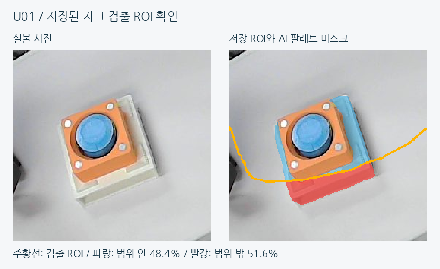

# YOLO·OpenCV 안착 검사와 오류 판정

기준일: 2026-10-19. 현재 **AI + OpenCV** 모드는 부품 종류·조립 상태에 YOLO 라벨을 우선하고, 정확한 안착 여부는 해당 라벨에 맞는 OpenCV·CAD 기준으로 판단한다. AI 마스크의 경계 이탈도 추가로 확인한다.

## 검사 흐름

1. 현재 영상에서 부품 라벨·신뢰도·전체 마스크를 얻고 고정 검사 위치에 연결한다. 여러 부품은 같은 영상의 AI 추론 결과를 공유한다.
2. 신뢰도 기준을 만족하고 위치에 유일하게 연결되는 AI 후보의 종류·조립 상태를 사용한다. 다중 후보·동률 연결·미검출은 확인 대기다.
3. 기존 CAD 분류와 다르면 같은 지그 좌표에서 AI 라벨에 해당하는 CAD 형상으로 다시 검사한다. 지그 좌표나 허용 범위를 이동하지 않는다.
4. 형상 근거·필수 부품·중심·각도·삽입·경계 조건으로 정상 여부를 판단한다. 기존에 확인한 기하학적 불량을 AI 라벨이 덮어쓰지 않는다.
5. 매우 어두운 배경 픽셀을 제외한 전체 AI 마스크로 안착 경계를 확인한다. 마스크를 허용 ROI로 잘라 이탈을 숨기지 않는다.
6. 실제 실행에서는 서로 다른 새 영상의 연속 관측·신선도·시간 제한을 별도로 확인한다. 단일 사진의 정상 표시만으로 에피소드 완료가 되지 않는다.

## 방식 선택

상단 카메라 → 부품·조립 검사에서 **OpenCV / AI + OpenCV**를 선택한 뒤 **검사 방식 적용**을 누른다. `적용 중` 표시가 실제 사용값이다. 지그 검출 설정과 안착검사 설정을 분리했으므로 한쪽을 바꿔도 다른 쪽이 함께 바뀌지 않는다. PC 검사와 Pi의 시작 전·스텝 검사는 적용한 설정을 사용한다.

OpenCV 모드는 기존 형상·색상·CAD 검사를 사용한다. AI + OpenCV 모드도 CAD 근거가 부족하면 정상으로 통과시키지 않는다. 빈 상태는 AI 부품 미검출만으로 판단하지 않고 빈 팔레트 형상·바닥 근거와 현재 지그 관측을 확인한다. 가려진 B 내부 체결이나 높이를 AI 완성품 라벨만으로 확정하지 않는다.

## 배경 때문에 생긴 두 문제

| 문제 | 원인 | 수정·확인 |
|---|---|---|
| LOAD_A 빈 팔레트 시간 초과 | 높은 적재물 후보까지 합친 영역에서 배경 색상·경계를 평가 | 빈 후보의 CAD 영역으로 계산하고 실제 보여야 할 구멍 바닥 근거 추가. 실패 당시 서로 다른 저장 영상 3장: 빈 상태 0/3 → 3/3 |
| 정상 A 완제품의 간헐적 오안착 | YOLO 마스크에 매우 어두운 뒤쪽 배경이 붙어 경계 비율이 1%를 넘음 | 기존 OpenCV와 같은 밝기 근거 V > 30 적용. 문제 영상 3장: 정상 1/3 → 3/3. 과거 A 사진 10/10 유지 |

전체 일치·외곽·빈 상태·경계 허용치와 연속 관측 조건은 유지했다. 실제 보이는 돌출부는 계속 불량이며 밝기 근거가 부족하면 대기한다. 밝은 배경·반사·주변 물체까지 부품으로 포함하는 경우는 여전히 영향을 줄 수 있다. 모든 배경에서의 오판 확률 감소율이나 장시간 현장 안정성은 측정하지 않았다.

## D01과 U01의 차이

| 사례 | 현재 설명 | 실행 판정 의미 |
|---|---|---|
| D01 | YOLO의 **A 하단+중단** 라벨 우선. 방향 차이 **19.8° / 허용 12°**, 중단 중심 편차 **6.9mm / 허용 3mm** | 이전 분류 불일치 보류 → 오안착 관측. AI가 상태를 바로잡아도 위치 불량은 유지 |
| U01 | 팔레트 마스크의 **48.4%**만 지그 검출 ROI 안. 요구 조건 **98%** 미달 | 안착검사 전 지그 위치 미확정. 정상·오안착을 추정하지 않고 위치 대기 이유 표시 |

## 속도와 정확도를 읽는 방법

| 측정 | 기존 OpenCV·CAD | AI 병행 |
|---|---:|---:|
| PC 영상당 평균 | 0.0753초 | 0.2523초 |
| Pi 빈 팔레트 사례 | 0.3220초 | 0.7250초 |
| Pi B 완제품 팔레트 사례 | 0.3344초 | 0.7087초 |

초기 AI 병행 검사의 실측이다. 같은 사진의 기존 검사와 AI를 추가한 복합 검사를 비교했으며, YOLO 단독 비교가 아니다. 준비 후 CPU 추론·검사를 포함하고 카메라·네트워크·UI는 제외했다. 최근 AI 라벨 우선 재검사까지 포함한 최종 처리 시간은 다시 측정하지 않았다.

초기 35개 검사 항목에서 정상 조건 29개와 부정 조건 6개의 통과 여부는 두 방식이 같았다. 현재 전체 정확도가 YOLO 때문에 더 높다고 단정하지 않는다. 최종 라벨 우선 변경은 저장 영상 45장·판정 입력 53개에서 정상 19건 유지, 불충족 32→33건, 보류 2→1건을 확인했다. 기존 불량이 정상으로 바뀌거나 기존 정상이 탈락한 사례는 없었다. 이는 단일 관측 비교이며 실제 에피소드 성공률이 아니다.
