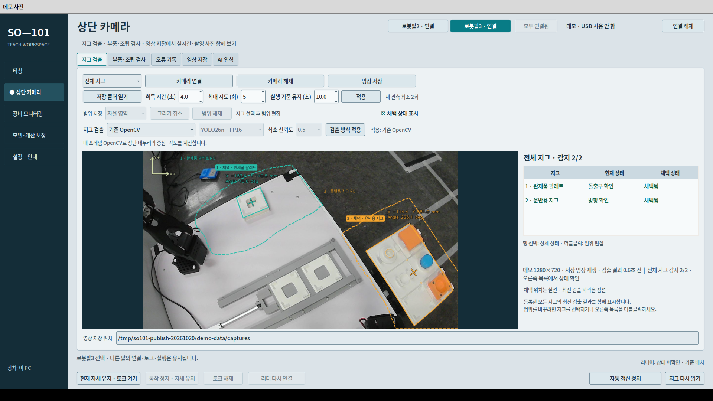

# 지그·안착 검사와 실행 준비 · 2026-10-20

현재 작업대의 기본 안착 검사는 **AI 라벨 + CAD**다. AI 분할 마스크는 부품을 슬롯에 연결하는 데 사용하며, 추가 마스크 경계 합격 조건은 제외했다. CAD 형상·위치·각도·삽입·빈 상태와 새 영상·연속 관측·제한시간 기준은 유지한다.

## 지그 채택과 화면

운반용 지그는 초기·재탐색의 AI 마스크와 현재 영상의 OpenCV 외곽·격자·방향 검증을 사용한다. 팔레트는 새 AI 마스크에 고정 CAD를 맞춘다. 첫 3회 조기 채택 후 새 관측이 기준을 벗어나면 미고정 좌표를 무효화하고 다시 획득한다. 전체 지그는 ROI·검출 거절 이유를 조회하는 화면이며, ROI 변경은 개별 지그에서 수행한다.

## Pi 비교 결과

실사진 304장(학습 243·검증 30·테스트 31)을 Pi YOLO26n NCNN FP16·신뢰도 0.5에서 비교했다. 기존 OpenCV·CAD, AI 라벨 + CAD, 추가 AI 마스크 경계 검사에 같은 검사 좌표를 적용했다.

| 지표 | OpenCV·CAD | AI 라벨 + CAD | 추가 마스크 경계 검사 |
|---|---:|---:|---:|
| 유일하게 연결된 가시 부품 라벨 일치 | 247/249 | 249/249 | 249/249 |
| 검사 좌표가 있는 284장의 처리 중앙값 | 0.356초 | 0.972초 | 0.970초 |
| 같은 284장의 처리 평균 | 0.937초 | 1.592초 | 1.602초 |
| 별도 수동 사례 53항목 | 정상 19·불충족 33·판정 불가 1 | 동일 | 동일 |

AI 라벨 연결은 분류 불일치를 줄였지만 이 자료에서 OpenCV보다 빠르지는 않았다. 추가 마스크 경계 검사는 수동 사례의 최종 판정을 바꾸지 않았다. 시간은 준비된 CPU 추론·후처리이며 디스크·카메라·전송·UI는 제외한다. 이후 시작 준비 최적화의 단발 측정과 이 표를 직접 혼합하지 않는다.

304장 전체는 독립 테스트셋이 아니다. 별도 수동 사진 44장·53항목에는 304장과 중복이 있다. 배포 후 348개 저장 사례·1,154개 판정 행이 평가한 라벨·CAD 결과와 일치했으나, 이는 저장 마스크를 사용한 동등성 재생이다. 라벨·마스크 정답은 물리적 안착·절대 위치 정답과 구분한다.

## 채택 시간

사진을 0.8초 간격의 61개 묶음으로 재생하고 Pi 실제 시계로 첫 채택을 측정했다. 최초 모델 준비·디스크·카메라·전송·UI는 제외했다.

| 현재 방식 | 운반용 지그 | 팔레트 |
|---|---:|---:|
| 첫 채택 / 전체 묶음 | 16/61 | 41/61 |
| 4초 시점 유지 | 16/61 | 38/61 |
| 첫 채택 중앙값 · 채택된 묶음 | 2.628초 | 2.478초 |
| OpenCV와 양쪽 채택한 묶음의 시간 절약 중앙값 | 1.384초 · 13묶음 | 1.523초 · 36묶음 |

일정 간격의 저장 사진 재생이므로 실제 카메라 지연으로 해석하지 않는다. 최초 채택 수와 4초 유지 수, 채택되지 않은 묶음도 함께 본다. 기존 10/19 실물·재생 자료와 입력이 달라 성공률을 합산하지 않는다.

## 시작 준비·관제

카메라·모델 예열을 팔 연결 준비와 병행한다. 안전 자세와 지그 위치가 준비되면 고정된 좌표의 경로 계산을 시작 검사·리니어 완료 확인과 병행하고, 모든 조건이 충족돼야 본 작업으로 진입한다. 같은 영상의 AI 결과를 공유하고 CAD 계산과 병행한다. 준비용 CAD 투영은 실제 관측 횟수로 세지 않는다. 리니어 위 대상은 리니어 완료 후 검사에 합류한다.

PC 관제는 `PREPARE_HOME`, `CLEAR_ERROR`를 지원한다. `BUILD_DONE`은 중간 조립 완료 알림이며 전체 완료는 Action Result를 기준으로 한다. 관제 소스는 [SO101_PC_Package](../../../SO101_PC_Package/README.md)에 있다.

## UI·3D

전체 지그 영상 확대, 형상 일치도 명칭, 만료 영상의 개수 초기화, AI 시작·TCP 적용 버튼 강조, 촬영 버튼 옆 삭제 대상 표시를 반영했다. 사진 기준의 공통 외관은 MuJoCo·Isaac Sim에 사용하며 제어 보정·티칭 좌표와 구분한다.

## 근거와 제한

- [집계 수치와 평가 범위](metrics.json)
- [작업·검증 기록](../../progress-2026-10-20.md)
- [Confluence 지그 설명](https://rorobot.atlassian.net/wiki/spaces/robot3/pages/39714835)
- [Confluence 현재 검사 기준](https://rorobot.atlassian.net/wiki/spaces/robot3/pages/39944193)

공개 데모는 저장 사진·가상 모터를 사용한다. 학습 가중치와 개인 장치 실행 설정은 포함하지 않는다. 새 A/B 전체 조립·운반 실행과 장시간 현장 정확도는 이번 갱신의 검증 결과가 아니다.
